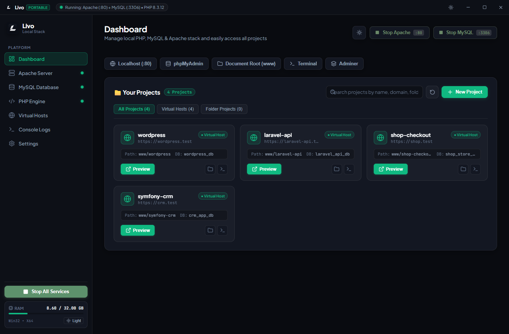
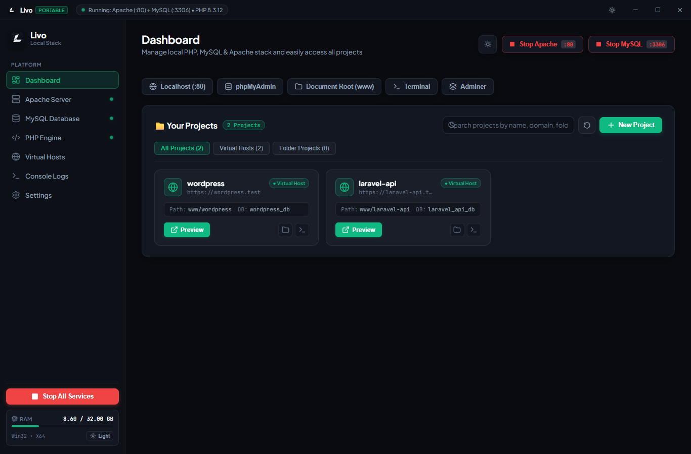
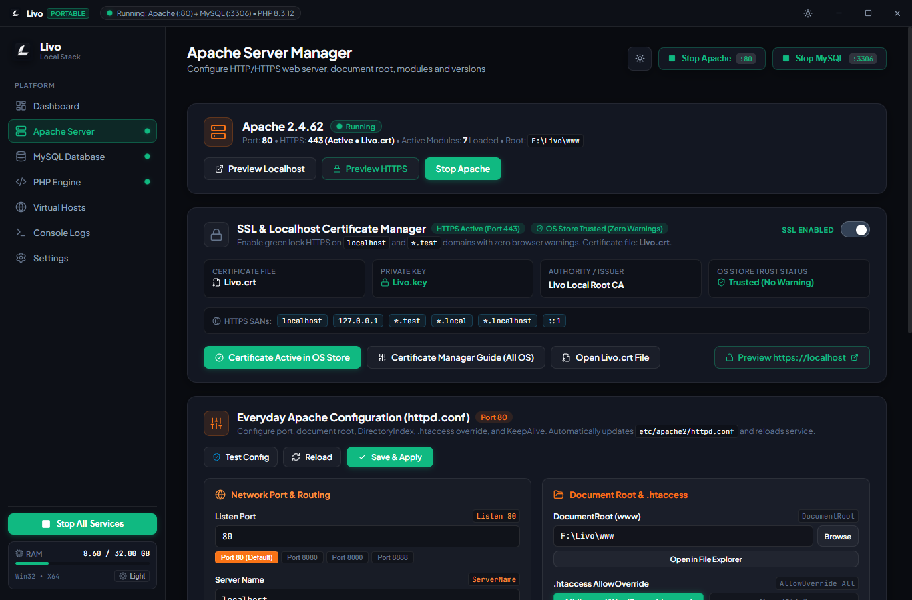
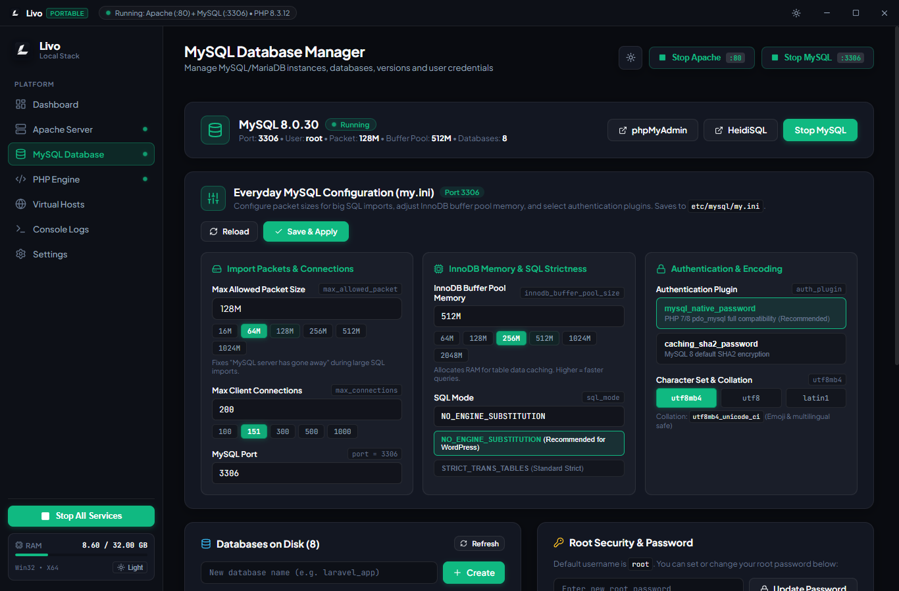
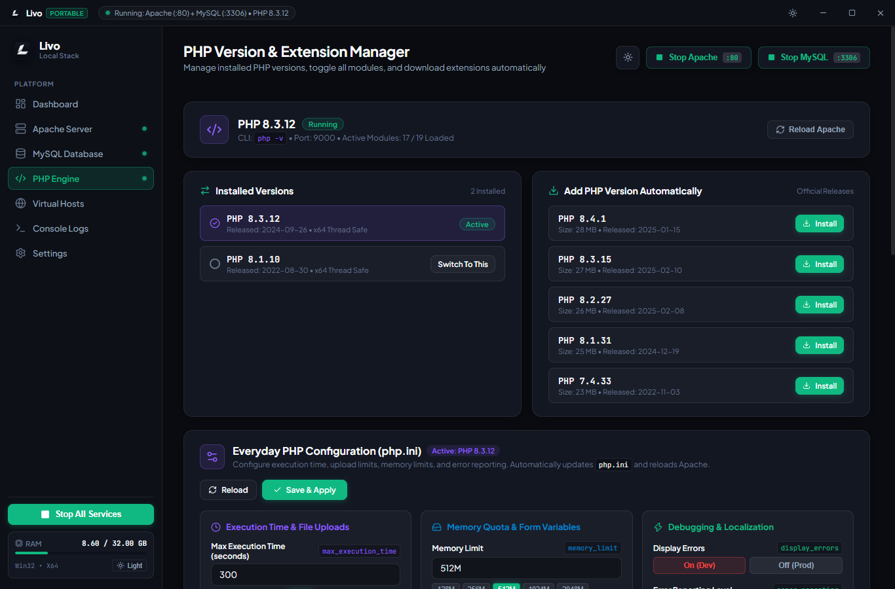
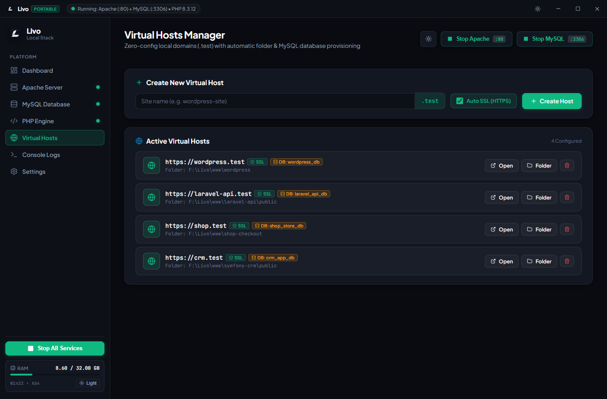
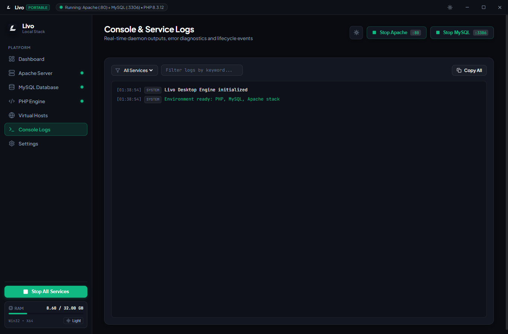
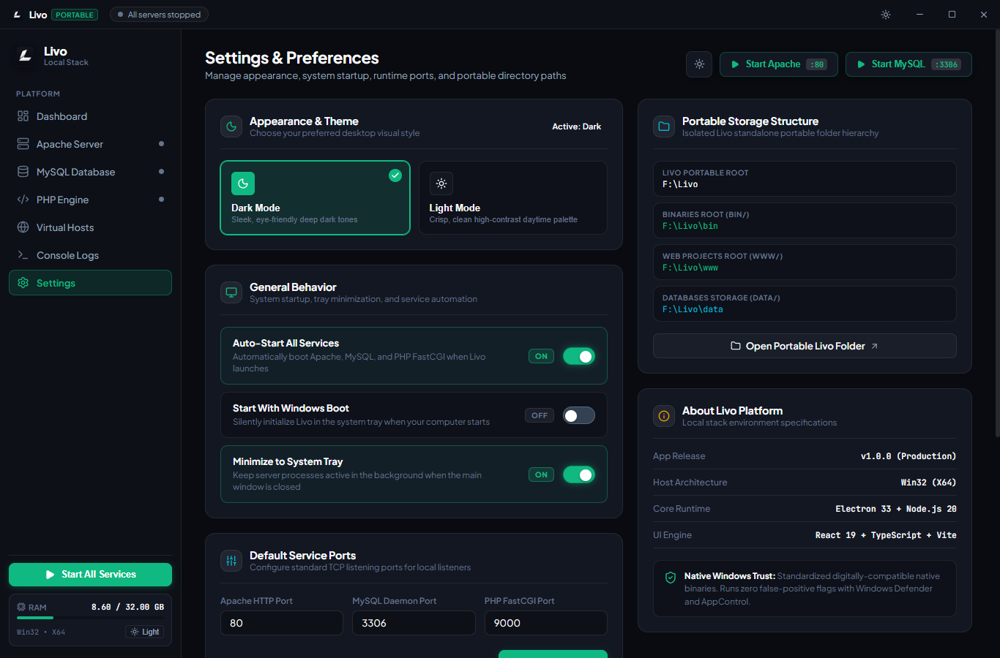
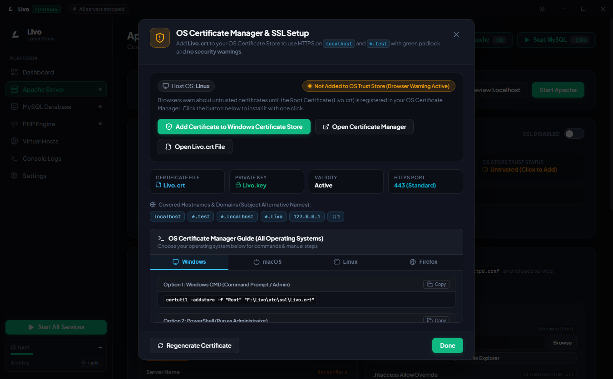

# <p align="center">Livo Local Stack</p>

<p align="center">
  <strong>The Ultra-Fast, Zero-Bloat, Fully Portable Local Web Development Environment</strong>
</p>

<p align="center">
  <em>Modern Apache 2.4 • MySQL 8.0 • Hot-Swappable PHP 7.4–8.4 • Built-in Local SSL CA • Zero-Config Virtual Hosts</em>
</p>

<p align="center">
  
  
  
  
  
  
  
</p>

---

## 📖 Table of Contents

- [Overview](#-overview)
- [Why Choose Livo?](#-why-choose-livo)
- [📥 Download Standalone Releases](#-download-standalone-releases)
- [Complete Feature Matrix](#-complete-feature-matrix)
  - [Dashboard & Service Management](#1-dashboard--service-management)
  - [1-Click App & Framework Installer](#2-1-click-app--framework-installer)
  - [Apache 2.4 Server Manager](#3-apache-24-server-manager)
  - [MySQL 8.0 Database Manager](#4-mysql-80-database-manager)
  - [PHP Version & Extension Switcher](#5-php-version--extension-switcher)
  - [Zero-Config Virtual Hosts (.test)](#6-zero-config-virtual-hosts-test)
  - [Local SSL & Certificate Authority (Zero Warnings)](#7-local-ssl--certificate-authority-zero-warnings)
  - [Real-Time Diagnostic Console & Logs](#8-real-time-diagnostic-console--logs)
  - [Preferences & Customization](#9-preferences--customization)
- [Illustrated Tutorial & Quickstart](#-illustrated-tutorial--quickstart)
  - [Step 1: Dashboard & Service Control](#step-1-launching-livo--controlling-services)
  - [Step 2: 1-Click Installing WordPress or Laravel](#step-2-1-click-installing-wordpress-or-laravel)
  - [Step 3: Apache Configuration & Syntax Testing](#step-3-apache-configuration--syntax-testing)
  - [Step 4: MySQL Databases & Management Tools](#step-4-managing-mysql-databases--tools)
  - [Step 5: Switching PHP Versions & Extensions](#step-5-switching-php-versions--enabling-extensions)
  - [Step 6: Creating Custom Virtual Hosts](#step-6-creating-custom-virtual-hosts)
  - [Step 7: Real-Time Diagnostic Log Streaming](#step-7-real-time-diagnostic-log-streaming)
  - [Step 8: System Preferences & Portable Paths](#step-8-system-preferences--portable-paths)
  - [Step 9: Trusting Local SSL in Your Operating System](#step-9-trusting-local-ssl-in-your-operating-system)
- [Distribution Layout & Directory Structure](#-distribution-layout--directory-structure)
- [Default Ports & Credentials](#-default-ports--credentials)
- [Standalone Distribution Packages & How to Run](#-standalone-distribution-packages--how-to-run)
- [Troubleshooting & FAQ](#-troubleshooting--faq)
- [License](#-license)

---

## 🌟 Overview

**Livo** is a next-generation local development stack distributed exclusively as **pre-compiled, ready-to-run standalone release packages**.

> [!IMPORTANT]
> **Zero Source Code Compilation & Zero Prerequisites!**  
> This release provides **100% pre-packaged, pre-compiled standalone distributions**. You do **not** need Node.js, npm, compilers, Python, Docker, or external dependencies installed on your system. Everything—including Apache 2.4, MySQL 8.0, PHP runtimes (7.4 through 8.4), Composer, Redis, HeidiSQL, and the Local Root Certificate Authority—is pre-bundled and pre-configured. Simply download, extract anywhere, and launch!

Built on high-performance native service orchestration and an ultra-modern glassmorphic interface, Livo replaces obsolete, monolithic tools like XAMPP, WampServer, and MAMP with an elegant, ultra-fast, and completely self-contained workflow.

Whether you are building enterprise **Laravel** applications, high-traffic **WordPress** sites, **Symfony** APIs, or bespoke PHP projects, Livo delivers zero-friction local development with instant service toggling, automated `.test` domain routing, and trusted HTTPS certificates out of the box.

```
                      ┌─────────────────────────────────────────┐
                      │            LIVO LOCAL STACK             │
                      │  Modern Glassmorphic Developer Suite    │
                      └────────────────────┬────────────────────┘
                                           │
         ┌──────────────────┬──────────────┴─────┬──────────────────┐
         ▼                  ▼                    ▼                  ▼
┌─────────────────┐┌─────────────────┐ ┌─────────────────┐ ┌─────────────────┐
│   Apache 2.4    ││    MySQL 8.0    │ │ PHP FastCGI     │ │ Local Root CA   │
│  HTTP (:80)     ││  Engine (:3306) │ │ Multi-Version   │ │ Trusted HTTPS   │
│  HTTPS (:443)   ││  + HeidiSQL     │ │ 7.4 / 8.2 / 8.3 │ │ Zero Browser    │
│  mod_rewrite    ││  + phpMyAdmin   │ │ / 8.4 Hot-Swap  │ │ Security Alerts │
└─────────────────┘└─────────────────┘ └─────────────────┘ └─────────────────┘
```

---

## ⚡ Why Choose Livo?

| Feature / Capability | Livo Local Stack | Legacy Stacks (XAMPP / Wamp) | Docker / VM Solutions |
| :--- | :---: | :---: | :---: |
| **User Interface** | Sleek Glassmorphic Dark/Light Mode | Outdated 90s Windows WinForms | CLI only / Heavy Web GUI |
| **Portability** | **100% Self-Contained** (No Registry keys) | Modifies Windows System Path | Requires hypervisor/WSL2 |
| **Local HTTPS / SSL** | **Built-in Root CA** (Zero browser warnings) | Manual OpenSSL CLI certificates | Complex reverse-proxy setup |
| **Virtual Hosts** | **Zero-Config** (Auto-updates `hosts` & Apache) | Manual manual edit of `vhosts.conf` | Complex network bridges |
| **CMS / Framework Setup** | **1-Click** (WP, Laravel, Symfony, OpenCart) | Manual download, extract, DB creation | Manual compose files |
| **PHP Hot-Swapping** | **Instant GUI Switch** (7.4, 8.2, 8.3, 8.4) | Manual path edits & service restarts | Multiple image rebuilds |
| **Resource Usage** | **Ultra-Lightweight** native execution | Moderate | Very heavy (RAM & battery drain) |

---

## 📥 Download Standalone Releases

Pre-compiled standalone packages ready to extract and run on your machine without an installer or dependencies:

| Platform | Package File | Format | Archive Size | Ready-to-Run Executable |
| :--- | :---: | :---: | :---: | :--- |
| **🪟 Windows 64-bit** | **`Livo-Windows-x64.zip`** | `.zip` | `~450 MB` | `Livo.exe` / `Livo-Launcher.bat` |
| **🍎 macOS 64-bit** | **`Livo-macOS-x64.zip`** | `.zip` | `~452 MB` | `Livo.app` / `Livo-Launcher.command` |
| **🐧 Linux x86_64** | **`Livo-Linux-x64.tar.gz`** | `.tar.gz` | `~157 MB` | `./Livo` |

> [!TIP]
> **Zero Configuration Required**: All dependencies including Apache, MySQL 8.0, multi-version PHP (8.4, 8.3, 8.2, 7.4), Composer, HeidiSQL, and the Local Root SSL Certificate Authority are included in each standalone package.

---

## 🚀 Complete Feature Matrix

### 1. Dashboard & Service Management
- **Centralized Service Control**: Start, stop, or restart **Apache**, **MySQL**, and **PHP FastCGI** individually or globally with a single click.
- **Real-Time Hardware Diagnostics**: Live monitoring of RAM allocation, system memory percentage, CPU model, architecture, and uptime.
- **Quick Action Bar**: Instant launchers for `http://localhost`, `phpMyAdmin`, `Adminer`, DocumentRoot (`www/`), and Terminal.
- **Unified Projects Overview**: Live gallery of all web projects with domain links, DocumentRoot paths, associated MySQL databases, and SSL badges.

### 2. 1-Click App & Framework Installer
- **Supported Pre-Configured Presets**:
  - 🔵 **WordPress** (6.7.x Latest) — Automatically injects `wp-config.php` database credentials and creates the database.
  - 🔴 **Laravel** (11.x LTS) — Automatically provisions `.env`, sets DB credentials, and maps DocumentRoot to `/public`.
  - ⚪ **Symfony** (7.2 Standard) — Sets up `.env.local` and maps DocumentRoot to `/public`.
  - 🛒 **OpenCart** (4.0.x) — Complete storefront deployment with database pre-configuration.
  - 🔥 **CodeIgniter** (4.5.x) — Ultra-fast micro-framework configuration.
  - 🐘 **Blank PHP Project** — Minimal boilerplate with MySQL connection check and `phpinfo()` inspector.
- **Automated Workflow**:
  1. Downloads official release archive directly from upstream repository.
  2. Extracts into project directory inside `www/`.
  3. Creates dedicated MySQL database (e.g. `myproject_db`).
  4. Generates custom virtual host domain (e.g. `https://myproject.test`).
  5. Injects database username (`root`), empty password, and database name into configuration files.

### 3. Apache 2.4 Server Manager
- **Dual Listeners**: Native HTTP (:80) and HTTPS (:443) OpenSSL-powered bindings.
- **Everyday Configuration Engine**:
  - Live port customizer (`80`, `8080`, `8000`, `8888`, or custom).
  - ServerName selector (`localhost`, `127.0.0.1`, custom).
  - Visual DocumentRoot directory picker.
  - DirectoryIndex customization (`index.php`, `index.html`, etc.).
  - `AllowOverride All` toggle for complete `.htaccess` rewrite compatibility.
  - HTTP KeepAlive connection toggles and timeouts.
- **Live Configuration Syntax Validator**: Executes `httpd -t` in the background and displays exact syntax confirmation or syntax error line numbers before reloading.
- **Module Manager**: Visual toggles for essential Apache modules:
  - `mod_rewrite` (URL rewriting engine for WordPress permalinks & Laravel routing)
  - `mod_ssl` (Local SSL/TLS encrypted traffic)
  - `mod_headers` (Custom HTTP response headers and CORS)
  - `mod_deflate` (Gzip/deflate compression for rapid asset delivery)
  - `mod_proxy` & `mod_proxy_fcgi` (FastCGI execution bridge)
  - `mod_expires` (Browser caching expiration headers)

### 4. MySQL 8.0 Database Manager
- **Database Server Core**: Standalone, sandboxed MySQL 8.0.41 server storing all databases in `data/mysql/`.
- **Integrated Database Admin Tools**:
  - **HeidiSQL**: One-click native GUI database manager launcher.
  - **phpMyAdmin**: Bundled, pre-configured browser-based database management.
  - **Adminer**: Ultra-lightweight single-file database administration interface.
- **Root Password Manager**: Securely update root password or clear it back to passwordless default in one click.
- **Live Database Inspector**: Lists all physical MySQL databases on disk with active table counts, sizes, and instant database creation.
- **Visual `my.ini` Engine**:
  - `max_connections` (Default: 151)
  - `innodb_buffer_pool_size` (Default: 256M)
  - `max_allowed_packet` (Default: 64M)
  - `default_storage_engine` (`InnoDB`)
  - `character_set_server` (`utf8mb4`)

### 5. PHP Version & Extension Switcher
- **Hot-Swappable Engines**: Seamlessly switch between PHP versions with zero Apache downtime:
  - **PHP 8.4** (Cutting-edge release)
  - **PHP 8.3** (Standard LTS — recommended)
  - **PHP 8.2** (Broad compatibility)
  - **PHP 7.4** (Legacy application maintenance)
- **1-Click Extension Toggles**: Turn PHP modules on and off instantly without touching configuration files:
  - `pdo_mysql` & `mysqli` (MySQL database drivers)
  - `curl` (HTTP requests, Stripe, API integrations)
  - `gd` & `mbstring` (Image processing and multi-byte UTF-8 string manipulation)
  - `opcache` (Zend bytecode accelerator for 3x PHP speedups)
  - `redis` (In-memory caching and session store)
  - `intl`, `zip`, `openssl`, `soap`, `fileinfo`, `exif`
- **Visual `php.ini` Tuner**:
  - `memory_limit` (128M / 256M / 512M / 1024M / 2048M)
  - `upload_max_filesize` (16M / 64M / 128M / 512M / 1024M)
  - `post_max_size` (16M / 64M / 128M / 512M / 1024M)
  - `max_execution_time` (30s / 60s / 120s / 300s / Unlimited)
  - `display_errors` (Development Debugging On / Off)
  - `date.timezone` (Visual timezone dropdown)

### 6. Zero-Config Virtual Hosts (.test)
- **Domain Auto-Mapping**: Create clean, professional local domains (e.g. `https://shop.test`, `https://api.test`).
- **System Hosts Integration**: Automatically writes entries into `C:\Windows\System32\drivers\etc\hosts` (or `/etc/hosts` on macOS/Linux).
- **Public Directory Detection**: Automatically recognizes `/public` or `/web` folders for modern frameworks like Laravel and Symfony.
- **Auto-Database Provisioning**: Option to automatically create a matching MySQL database when registering a virtual host.
- **Instant SSL Association**: Every virtual host automatically receives wildcard SSL certificate coverage for HTTPS.

### 7. Local SSL & Certificate Authority (Zero Warnings)
- **Built-in Root CA**: Custom 2048-bit RSA Root Certificate Authority (`Livo Local Root CA`).
- **Comprehensive Subject Alternative Names (SANs)**:
  - `localhost`
  - `127.0.0.1`
  - `*.test`
  - `*.local`
  - `*.localhost`
  - `::1`
- **1-Click Operating System Trust Integration**:
  - **Windows**: Installs directly into `Trusted Root Certification Authorities` via `certutil -addstore -f "Root" "Livo.crt"`.
  - **macOS**: Installs into `login.keychain` via `security add-trusted-cert`.
  - **Linux**: Installs into `/usr/local/share/ca-certificates/` and runs `update-ca-certificates`.
  - **Mozilla Firefox**: Step-by-step GUI import guide for Firefox's independent certificate database.
- **Green Padlock Guarantee**: Eliminates `NET::ERR_CERT_AUTHORITY_INVALID` and self-signed security warnings in Chrome, Edge, Safari, and Brave.

### 8. Real-Time Diagnostic Console & Logs
- **Live Output Streaming**: View combined stdout/stderr streams from Apache, MySQL, and PHP FastCGI.
- **Service Filtering**: Filter logs by service (`Apache`, `MySQL`, `PHP`, `System`).
- **Severity Levels**: Color-coded badges for `INFO`, `WARN`, and `ERROR`.
- **Search & Clipboard**: Real-time keyword search, auto-scroll to latest line, and 1-click Copy All Logs to clipboard.

### 9. Preferences & Customization
- **Theme Switcher**: Instant transition between ultra-dark Obsidian glassmorphism and clean light mode.
- **System Tray Mode**: Minimize Livo to the system notification area while services remain active in the background.
- **Auto-Start Options**: Option to start Livo and all services on system login.
- **Storage Path Visualizer**: Displays paths to `bin/`, `data/`, `etc/`, `www/`, and `tmp/`.

---

## 📸 Illustrated Tutorial & Quickstart

Follow this visual step-by-step walkthrough to get up and running with Livo in under two minutes.

### Step 1: Launching Livo & Controlling Services

When you first launch Livo, you are greeted by the centralized **Dashboard**. All services are monitored with real-time status pills.

1. Click **Start All Services** in the bottom left or start **Apache** and **MySQL** individually using the top header buttons.
2. The indicator turns bright green (`Running: Apache (:80) + MySQL (:3306) + PHP 8.3.16`).
3. Use the quick launch buttons to open `Localhost (:80)`, `phpMyAdmin`, or the DocumentRoot folder (`www/`).

<p align="center">
  
</p>

---

### Step 2: 1-Click Installing WordPress or Laravel

Creating a complete web application with a connected database takes just one click:

1. Click the **+ New Project** button on the Dashboard.
2. The **1-Click App & Framework Installer** opens. Choose your framework or CMS:
   - **WordPress** — Latest official core.
   - **Laravel** — Full modern web stack.
   - **Symfony**, **OpenCart**, **CodeIgniter**, or **Blank PHP**.
3. Enter your project name (e.g. `shop-store`).
4. Keep **Enable Virtual Host (`.test`)** and **Enable HTTPS / Local SSL** checked.
5. Click **Install**. Livo will download the package, extract it into `www/`, provision a MySQL database, map the `.test` domain, and open your new site in the browser!

<p align="center">
  
</p>

---

### Step 3: Apache Configuration & Syntax Testing

Need to change your HTTP port, alter DocumentRoot, or verify your `.htaccess` rules?

1. Navigate to **Apache Server** in the left sidebar.
2. Adjust your **Listen Port** (`80`, `8080`, `8000`), ServerName, or DocumentRoot directory.
3. Toggle modules like `mod_rewrite` and `mod_ssl` on or off.
4. Click **Test Config** — Livo will run Apache's native syntax validator and confirm `Syntax OK` with zero downtime risk.
5. Click **Save & Apply** to instantly reload the configuration.

<p align="center">
  
</p>

---

### Step 4: Managing MySQL Databases & Tools

Manage your relational databases, credentials, and performance settings with ease:

1. Navigate to **MySQL Database** in the sidebar.
2. Launch **HeidiSQL** (for native desktop administration) or open **phpMyAdmin** in your browser.
3. View all existing databases stored in `data/mysql/`.
4. Enter a name in **Create New Database** and click create to instantly provision a database.
5. Use the **Root Password Manager** to set or reset your database credentials.
6. Tune your database memory limits (`innodb_buffer_pool_size`, `max_connections`) via the visual `my.ini` editor.

<p align="center">
  
</p>

---

### Step 5: Switching PHP Versions & Enabling Extensions

Switch PHP runtimes effortlessly between projects:

1. Navigate to **PHP Engine** in the sidebar.
2. Select your desired PHP version from the **Active PHP Version** grid:
   - **PHP 8.4** for newest syntax features.
   - **PHP 8.3** for standard production environments.
   - **PHP 8.2** or **PHP 7.4** for legacy projects.
3. Toggle essential extensions (`pdo_mysql`, `curl`, `gd`, `opcache`, `redis`) on or off with instant visual switches.
4. Adjust memory limits (`memory_limit = 512M`) and upload sizes (`upload_max_filesize = 128M`) using the visual sliders.

<p align="center">
  
</p>

---

### Step 6: Creating Custom Virtual Hosts

Eliminate ugly URLs like `localhost/myproject/public` and use clean `.test` domains:

1. Navigate to **Virtual Hosts** in the sidebar.
2. Enter your project folder name or custom domain (e.g. `api-gateway.test`).
3. Select your DocumentRoot path (auto-detects `/public` for Laravel).
4. Check **Enable HTTPS (Local SSL)** to activate zero-warning encryption.
5. Click **Add Virtual Host**. Livo automatically updates your operating system's `hosts` file and reloads Apache!

<p align="center">
  
</p>

---

### Step 7: Real-Time Diagnostic Log Streaming

Troubleshoot PHP errors, MySQL queries, and Apache routing issues instantly:

1. Navigate to **Console Logs** in the sidebar.
2. View live color-coded output from all running services.
3. Use the **Service Filter** dropdown to isolate Apache, MySQL, or PHP logs.
4. Type in the **Search Logs** box to quickly filter for specific errors or stack traces.
5. Click **Copy All** to easily share log excerpts with teammates or AI assistants.

<p align="center">
  
</p>

---

### Step 8: System Preferences & Portable Paths

Tailor Livo to fit your exact development workflow:

1. Navigate to **Settings** in the sidebar.
2. Toggle between **Dark Mode** and **Light Mode** according to your preference.
3. Configure **System Startup** and **Minimize to System Tray** behavior.
4. Verify all portable paths (`bin/`, `data/`, `etc/`, `www/`, `tmp/`).

<p align="center">
  
</p>

---

### Step 9: Trusting Local SSL in Your Operating System

Say goodbye to red `Not Secure` warnings and broken local HTTPS APIs forever:

1. On the **Apache** or **Settings** page, click **Certificate Manager Guide (All OS)**.
2. The **OS Certificate Manager & SSL Setup** modal displays the active trust status.
3. Click **Add Certificate to Windows Certificate Store** (or view instructions for macOS, Linux, and Firefox).
4. Livo automatically registers `Livo.crt` as a trusted Root Certificate Authority.
5. Restart your browser — all `https://localhost` and `https://*.test` domains will now display the trusted **green padlock**!

<p align="center">
  
</p>

---

## 📁 Distribution Layout & Directory Structure

This release package is **100% portable and self-contained**. You can place it on any drive letter (e.g. `C:\Livo`, `F:\Livo`, or a USB flash drive) and run it without running an installer or touching system settings:

### 📦 Top-Level Release Structure
```
deploy/
├── windows/
│   └── Livo-win32-x64/           # Pre-compiled standalone Windows 64-bit stack
│       ├── Livo.exe              # Main desktop application executable
│       ├── Livo-Launcher.bat     # Quick desktop launcher script
│       ├── Livo-Terminal.bat     # Pre-configured CMD with portable PHP/Composer
│       ├── Livo-Database.bat     # Direct HeidiSQL launcher
│       ├── Clear-Windows-Icon-Cache.bat
│       ├── bin/                  # Embedded Apache, MySQL, PHP, Redis, HeidiSQL
│       ├── data/mysql/           # MySQL database storage
│       ├── etc/                  # Configs (httpd.conf, php.ini, my.ini, SSL)
│       ├── www/                  # Projects DocumentRoot
│       └── tmp/                  # Runtime session files
├── macos/
│   ├── Livo-darwin-x64/          # Standalone macOS distribution (Livo.app)
│   ├── Livo-Launcher.command     # macOS launch helper script
│   ├── Livo-Start-Server.command # Quick-start local web server
│   ├── Livo-Terminal.command     # Terminal session with portable PHP/Composer in PATH
│   ├── Livo-Database.command     # Direct Adminer database launcher
│   └── README-macOS.txt          # macOS quick-reference notes
├── linux/
│   └── Livo-linux-x64/           # Standalone Linux x64 distribution
│       └── Livo                  # Main Linux binary (executable)
├── screenshots/                  # High-resolution application preview screenshots
└── README.md                     # Documentation and quickstart guide
```

### 🗄️ Internal Standalone Architecture (Inside `Livo-win32-x64`)
```
Livo-win32-x64/
├── bin/                          # Standalone official binaries
│   ├── apache24/                 # Apache 2.4.63 (Win64 OpenSSL 3.2)
│   ├── mysql80/                  # MySQL 8.0.41 Community Server
│   ├── php/                      # Multi-Version PHP Engines
│   │   ├── php-8.4/              # PHP 8.4 NTS x64
│   │   ├── php-8.3/              # PHP 8.3 NTS x64 (Active Default)
│   │   ├── php-8.2/              # PHP 8.2 NTS x64
│   │   └── php-7.4/              # PHP 7.4 NTS x64
│   ├── composer/                 # Composer 2.x CLI executable
│   ├── redis/                    # Redis in-memory server
│   ├── heidisql/                 # HeidiSQL Portable Database GUI
│   └── sendmail/                 # Local mail-catcher utility
├── data/                         # Persistent application data
│   └── mysql/                    # MySQL physical database tables & schemas
├── etc/                          # Isolated configuration files
│   ├── apache2/                  # httpd.conf, vhosts.conf, modules
│   ├── mysql/my.ini              # MySQL performance configuration
│   ├── php/php.ini               # Active PHP configuration
│   ├── ssl/                      # Livo.crt (Root CA) & Livo.key
│   └── apps/                     # phpMyAdmin & Adminer web interfaces
├── www/                          # Your web projects (DocumentRoot)
│   ├── wordpress/                # Sample WordPress project
│   └── laravel-api/              # Sample Laravel project
├── tmp/                          # Session storage & temporary runtime files
└── Livo.exe                      # Application executable
```

---

## 🔌 Default Ports & Credentials

| Service | Port | Default Username | Default Password | Notes |
| :--- | :---: | :---: | :---: | :--- |
| **Apache HTTP** | `80` | — | — | Can be changed to `8080`, `8000`, etc. |
| **Apache HTTPS** | `443` | — | — | TLS 1.3 / OpenSSL with `Livo.crt` |
| **MySQL Server** | `3306` | `root` | *(empty)* | Connect host: `127.0.0.1` or `localhost` |
| **PHP FastCGI** | `9000` | — | — | FastCGI listener spawned by Livo |
| **phpMyAdmin** | `80` | `root` | *(empty)* | Accessible at `http://localhost/phpmyadmin/` |
| **Adminer** | `80` | `root` | *(empty)* | Accessible at `http://localhost/adminer/` |
| **Virtual Hosts** | `80` / `443` | — | — | Maps to `127.0.0.1` (e.g. `https://mysite.test`) |

---

## 📦 Standalone Distribution Packages & How to Run

Livo is distributed as **pre-compiled, standalone, zero-dependency release packages**. No installation wizard, no source code compilation, and no global runtime dependencies are required.

### 🪟 Windows (64-bit) — Ready to Run
Located in: `windows/Livo-win32-x64/`

1. Open the folder `windows/Livo-win32-x64/`.
2. Double-click **`Livo.exe`** (or `Livo-Launcher.bat`).
3. The Livo dashboard will open immediately.
4. Click **Start All Services** to activate Apache, MySQL, and PHP FastCGI.

> [!TIP]
> **Convenience Batch Utilities**:
> - **`Livo-Terminal.bat`**: Opens a Command Prompt pre-configured with portable PHP (`php -v`), Composer (`composer -v`), and MySQL client in your session PATH.
> - **`Livo-Database.bat`**: Directly launches HeidiSQL to administer MySQL databases without having to open the dashboard.
> - **`Clear-Windows-Icon-Cache.bat`**: Refreshes the Windows Explorer icon cache if shortcut icons appear blank.

---

### 🍎 macOS (Intel & Apple Silicon via Rosetta 2)
Located in: `macos/`

1. Open the `macos/` folder.
2. Double-click **`Livo.app`** (located inside `Livo-darwin-x64/`) or run **`Livo-Launcher.command`**.
3. **macOS Helper Scripts**:
   - **`Livo-Start-Server.command`**: Quickly launches the standalone PHP development server at `http://localhost:8080`.
   - **`Livo-Terminal.command`**: Opens Terminal with the portable PHP 8.3 runtime and Composer CLI mapped into your PATH.
   - **`Livo-Database.command`**: Opens the web database management client in your browser.

---

### 🐧 Linux (x86_64)
Located in: `linux/Livo-linux-x64/`

1. Open a terminal in `linux/Livo-linux-x64/`.
2. Ensure the binary has execute permissions:
   ```bash
   chmod +x Livo
   ```
3. Run Livo:
   ```bash
   ./Livo
   ```
4. All services (Apache, MySQL, PHP) execute safely in user space without requiring root/sudo privileges for daily development.

---

### 🛡️ Zero System Footprint Guarantee
- **No Registry Keys**: Livo never creates or modifies keys in `HKEY_CURRENT_USER` or `HKEY_LOCAL_MACHINE`.
- **No Global PATH Pollution**: Livo never alters your machine's global environment variables.
- **True Portability**: Move the folder anywhere (e.g. from `C:\` to `F:\` or a USB flash drive) and all services continue to work seamlessly.

---

## ❓ Troubleshooting & FAQ

### Port 80 is already in use by another application
- **Symptom**: Apache fails to start with `Address already in use: make_sock: could not bind to address 0.0.0.0:80`.
- **Solution**:
  1. Open Livo and navigate to **Apache Server**.
  2. Change the **Listen Port** from `80` to `8080` (or `8000`).
  3. Click **Save & Apply**.
  4. Alternatively, disable Windows World Wide Web Publishing Service (`IIS`) via Windows Services.

### Virtual Host `.test` domain does not resolve in browser
- **Symptom**: Browser reports `DNS_PROBE_FINISHED_NXDOMAIN`.
- **Solution**:
  1. Ensure Livo has permission to write to `C:\Windows\System32\drivers\etc\hosts`.
  2. If running on restricted Windows environments, launch Livo once as Administrator, or add the entry manually:
     ```
     127.0.0.1  mysite.test
     ```
  3. Flush DNS in terminal: `ipconfig /flushdns`.

### Chrome displays "Not Secure" warning on `*.test` domains
- **Symptom**: `NET::ERR_CERT_AUTHORITY_INVALID`.
- **Solution**:
  1. Open Livo -> **Apache Server** -> click **Certificate Manager Guide (All OS)**.
  2. Click **Add Certificate to Windows Certificate Store** (or run `certutil -addstore -f "Root" "F:\Livo\etc\ssl\Livo.crt"`).
  3. Completely restart Google Chrome / Brave / Edge (`chrome://restart`).
  4. Enjoy 100% green-padlock HTTPS!

---

## 📄 License

Livo is open-source software licensed under the **[MIT License](LICENSE)**.

Apache, MySQL, PHP, WordPress, Laravel, Symfony, OpenCart, CodeIgniter, and HeidiSQL are trademarks of their respective owners.

<p align="center">
  Crafted with ❤️ for developers who appreciate speed, elegance, and simplicity.
</p>
